# Hypn0 (HypnoSVG)

---

  <b>English</b> •
  <a href="README.ru.md">Русский</a>

---

Procedural vector halftone SVG animation generator. Transforms raster images into scalable, hypnotic vector artwork composed of pulsating geometric matrices.

---

> ### 🐸 Note on Theme & Interface (Lore vs Production Utility)
> **Hypn0** is styled with a playful, satirical sci-fi theme inspired by *Futurama*, the **Hypnotoad**, Brain Slugs, and New New York bureaucracy.
> 
> * **Intuitive Visual UI:** You don't need to decipher the lore or speak any specific language to use the generator — all controls (shape selectors, grid density, animation sliders, color pickers) are visual, responsive, and self-explanatory.
> * **Production-Ready Vectors:** While the theme is humorous, the generated SVGs are 100% professional, production-ready, ultra-lightweight assets designed for real-world web design, UI/UX, marketing, and digital fabrication.

---

## What It Is & Why Use It

**Hypn0** decomposes photos, logos, and graphics into procedural geometric shapes (circles, rings, diamonds, snowflakes, binary "0/1" code, stars, hearts) with individual per-element phase-shifted CSS keyframe animations.

The result is a clean, standalone `.svg` file (typically 20–50 KB) that runs natively in any browser with **zero JavaScript execution overhead**.

### Where to Use:
- **UI/UX & Web Design:** Lightweight animated preloaders, Hero background textures, interactive 404 backdrops, and Dark Mode atmospheric layers (replaces heavy GIFs and video loops).
- **Marketing & SMM:** Dynamic display banners, attention-grabbing CTA elements, podcast/album cover art, and YouTube thumbnails that overcome banner blindness.
- **Game Dev & Sci-Fi Interfaces:** Procedural terminals, radar displays, scanning grids, holographic force fields, and cyberpunk HUDs.
- **VJing & Live Streaming:** Animated stream overlays for OBS/Twitch and seamless generative visual loops for live performances.
- **CNC & Digital Fabrication:** Scalable vector paths for laser engraving, vinyl cutting, plotter drawing, and screen printing / apparel merch.

---

## Key Features

- **12+ Procedural Shapes:** circles, rings, diamonds, squares, triangles, hexagons, snowflakes, binary code, crosses, stars, hearts, and linear hatching.
- **Full Rasterization Control:** adjustable grid density, maximum radius, brightness, contrast, thresholding, monotone, duotone, and inverted color palettes.
- **Pure CSS @keyframes:** radius pulsation (breathing), luminescence flicker, rotation sway, and traveling wave effects without CPU rendering penalties.
- **Community Trance Gallery:** a three-tier curation system (*Incubator* &rarr; *Approved by Brain Slug* &rarr; *Deep Trance Hall of Fame*) powered by an automated logarithmic time-decay gravity ranking algorithm.

---

## Output Preview

---

## Documentation & Links

- **AI & LLM Integration:** [public/llms.txt](public/llms.txt) — structured project context and intent triggers for LLMs and AI agents.
- **Frontend Assembly:** [frontend-assembly/README.md](frontend-assembly/README.md) `(RU)` — build scripts for Alpine.js, Tailwind CSS, and HTMX.
- **Security & Privacy:** [SECURITY.md](SECURITY.md) `(RU)` — Zero-PII architecture, default no-tracking mode, and anti-abuse mechanisms.
- **Roadmap & Architecture:** [_blueprint/plan-draft.md](_blueprint/plan-draft.md) `(RU)` — architectural drafts and implementation plans.
- **Legacy CLI Prototype:** [2026-image-hatftone-effect](https://git.cube2.ru/erjemin/2026-image-hatftone-effect) `(RU)` — original prototype utility.
- **Contributing Guidelines:** [CONTRIBUTING.md](CONTRIBUTING.md) `(RU)` — code style, rules, and workflow for contributors.
- **Code of Conduct:** [CODE_OF_CONDUCT.md](CODE_OF_CONDUCT.md) `(RU)` — community interaction standards.

---

## License

- **Source Code:** [PolyForm Noncommercial 1.0.0](LICENSE.md) (free non-commercial use).
- **Generated SVG Artwork:** [CC0 1.0 Universal](LICENSE.md) (free for personal and commercial use without attribution).
